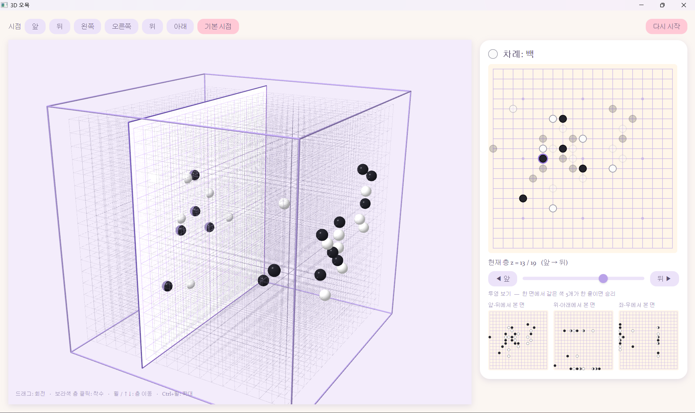

# 3D 오목 (omok3d)

## 미리보기


## 실행 방법

| 도구 | 버전 | 확인 |
|---|---|---|
| JDK | 17 이상 (21 권장) | `java -version` |
| Maven | 3.9 이상 | `mvn -v` |   
  
<br>

Maven 없으면  
https://maven.apache.org/download.cgi#CurrentMaven 에서  
**apache-maven-3.10.0-bin** 파일 다운 후 압축 풀고  
환경변수 경로 설정 ex) C:\tools\maven\apache-maven-3.10.0\bin

### 실행

```bash
git clone "https://github.com/Jeon-ChanYoung/omok3d.git"
cd omok3d
mvn javafx:run
```
### VSCode에서 실행

1. 확장 **Extension Pack for Java**를 설치
2. src/main/java/Launcher.java 실행

## 프로젝트 구조

```
omok3d/
├─ pom.xml                         빌드 설정 (JavaFX 21, JUnit 5)
├─ src/
│  ├─ main/
│  │  ├─ java/omok3d/
│  │  │  ├─ Board.java             19³ 보드, 착수, 투영 기반 승리 판정 (UI와 무관한 순수 로직)
│  │  │  ├─ App.java               JavaFX UI (3D 뷰, 평면도, 미니맵, 입력 처리)
│  │  │  └─ Launcher.java          IDE/jar 실행용 진입점
│  │  └─ resources/
│  │     └─ style.css              UI 스타일 (파스텔 테마)
│  └─ test/java/omok3d/
│     └─ BoardTest.java            승리 판정 단위 테스트
├─ .github/                        CI(GitHub Actions), PR 템플릿
└─ .vscode/                        VSCode 공용 설정
```

**게임 규칙은 `Board`, 화면은 `App`**으로 분리됨. 규칙을 바꿀 때는 `Board`와 `BoardTest` 수정